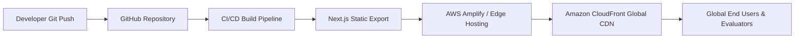

# ⚡ Tech Superpower Portfolio & Skill Forge

<p align="center">
  
</p>

<p align="center">
  <a href="https://swatiicfai.github.io/aws-superpower-portfolio/"></a>
  <a href="https://github.com/swatiicfai/aws-superpower-portfolio"></a>
  
  
</p>

---

## 🏆 AWS Student Builder Challenge Submission
- **Challenge:** [AWS Student Builder Challenge: Build Your Tech Superpower](https://builder.aws.com/build/hackathons/3bff5627-ef21-3bfc-acfc-fce21d39a4f6/aws-student-builder-challenge-build-your-tech-superpower)
- **Live Demo Endpoint:** [https://swatiicfai.github.io/aws-superpower-portfolio/](https://swatiicfai.github.io/aws-superpower-portfolio/)
- **Author:** Swati ([@swatiicfai](https://github.com/swatiicfai))

---

## 🌟 The Core Superpower: "The Cloud Alchemist" & Skill Forge

To score maximum points in the challenge's **Creativity & Memorability (35% weight)** rubric, this portfolio introduces a dual-experience interface:

### 1. Interactive Superpower Skill Forge
- Located on the top navigation and throughout the page via the **"Skill Forge"** HUD.
- Visitors can pick 2 to 3 tech building blocks (*AWS Amplify Hosting*, *Serverless Compute*, *Next.js & React*, *Strict TypeScript*, *Tailwind Styling*, *Amazon DynamoDB*).
- Clicking **"Synthesize Superpower"** executes a dynamic synthesis engine that reveals unique tech traits accompanied by celebratory particle physics.

### 2. Integrated Builder CLI HUD
- A floating developer terminal (`builder-cli@swati:~`) available directly on the web page.
- Supports interactive commands:
  - `help` : Lists all commands
  - `superpower` : Displays the core Tech Superpower and secret builder philosophy
  - `aws` : Explains the AWS Amplify architecture and edge deployment
  - `skills` : Lists full-stack and cloud competency categories
  - `projects` : Summarizes featured serverless projects and AWS integrations
  - `about` : Prints developer background and story
  - `clear` : Clears the console output

---

## ☁️ AWS Architecture & Cloud Design

The project is architected with modern cloud delivery principles:



- **AWS Amplify Hosting**: Continuous deployment configuration via [`amplify.yml`](./amplify.yml). Any push triggers automated dependency caching, Next.js asset compilation, and global distribution.
- **Amazon CloudFront CDN**: Delivers sub-second asset latency, edge caching, and zero-configuration SSL/TLS encryption.
- **Amazon Route 53 (Optional)**: Ready for custom DNS mapping and alias record routing.
- **AWS CloudWatch**: Monitored builds, continuous telemetry, and status tracking.

---

## 📋 Challenge Requirements Checklist

- [x] **Public Live URL**: Hosted and active at [https://swatiicfai.github.io/aws-superpower-portfolio/](https://swatiicfai.github.io/aws-superpower-portfolio/)
- [x] **Core Section 1: About Me**: Background, cloud builder vision, and location badge.
- [x] **Core Section 2: Skills / Tech Superpowers**: Comprehensive skill matrix across AWS DevOps, Full-Stack, and Core Competencies.
- [x] **Core Section 3: Projects & Achievements**: Project showcase featuring real-world serverless applications with tagged AWS services.
- [x] **Creative Feature**: Functional **Superpower Skill Forge** + **CLI Terminal HUD** that enhances engagement without disrupting navigation.
- [x] **Clean Documentation**: Full setup guide, architecture diagrams, and submission documentation.

---

## 🛠️ Local Development & Setup

```bash
# 1. Clone repository
git clone https://github.com/swatiicfai/aws-superpower-portfolio.git
cd aws-superpower-portfolio

# 2. Install dependencies
npm install

# 3. Start local development server
npm run dev
```

Visit `http://localhost:3000` to interact with the portfolio locally.

---

## 🚀 Deployment Instructions

### AWS Amplify Hosting (Recommended)
1. Fork or clone this repository.
2. In the [AWS Management Console](https://console.aws.amazon.com/amplify/), click **Host web app**.
3. Select **GitHub** &rarr; choose `aws-superpower-portfolio` (branch: `main`).
4. Amplify will automatically detect the bundled [`amplify.yml`](./amplify.yml).
5. Click **Save and Deploy**.

### GitHub Pages (Active Live Backup)
- Uses the included automated GitHub Action [`.github/workflows/deploy.yml`](./.github/workflows/deploy.yml) that builds and deploys static assets to GitHub Pages on every push.

---

## 📄 License
MIT License • Built with ❤️ for the AWS Student Builder Challenge.
